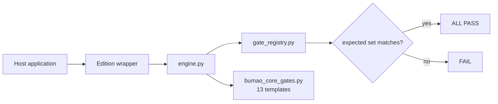

# Bumao Core
[](https://hub.xerj.org/contributors/Bumao-Ai)

Status: maintenance pause


> **Two version spaces** — the kernel version declared in `kernel_contract.json` is `0.10`; the repository tag is a separate numbering space. The latest non-prerelease Release is `v0.2.6`; the 0.3 beta line (`v0.3.0-beta.1` … `v0.3.0-beta.4`) is published as Pre-release and is not counted as an official release; `v0.2.1` was published, not skipped. They are independent numbers, not the same number.
>
> **Cold start** — to resume iteration, start from [`RETURN_HERE.md`](RETURN_HERE.md).

Stdlib-only rule-execution kernel for AI agents: one written rule set in, one deterministic `ALL PASS` / `FAIL` verdict out — and the verdict cannot be silently loosened.

**What it is** — a kernel, not a framework. It ships no rules of its own.
**Who it's for** — developers building their own host who want the same verdict logic underneath.
**What it solves** — the same rule set being judged differently by different implementations.


*Real output: `test_check_rc.py` plus the shipped `bumao_core/` tree. Terminal capture, no mock UI.*

## Quick start (30 seconds)

```bash
git clone -b v0.2.6 https://github.com/Bumao-Ai/Bumao-core.git
cd Bumao-core
python bumao_core/test_check_rc.py     # smoke test, prints PASS
```

Then wire it into your own host. The snippet below runs from the repository root; two symbols are yours to supply and are marked `# replace`:

```python
import sys
sys.path.insert(0, "bumao_core")                  # repo-relative, no change needed
import engine as core

core.configure(rules_db_module=my_rules_db)       # replace my_rules_db with your rules module
core.register("B1", my_gate, "my first gate")     # replace my_gate with your gate function
core.set_expected("MyEdition", frozenset(["B1"])) # anti-shrink baseline
raise SystemExit(core.main(["check", "--strict"]))# exit code is the verdict
```

Two symbols are host-supplied: `my_rules_db` (your rules module) and `my_gate` (your gate function). Everything else in the block is copy-paste as is.

Subcommands: `whoami` (`--full`), `check` (`--strict`, `--quick`), `audit`, `bump`, `show <clause-id>`, `selftest` (`--kernel`), `refresh`.

- `check --quick` runs the A-section structural gates only; it skips the host-injected B/Z gates, the anti-shrink reconciliation and the check-credential write. Its verdict line says it cannot replace `check --strict` in both branches: `[结论] ALL PASS（quick：仅 A 段 N 项，B/Z 段未跑）—— 不能替代 check --strict` on pass, and `FAIL (…；quick 仅 A 段，B/Z 未跑 —— 不能替代 check --strict)` on fail.
- `--strict` is a legacy-compatible flag: every FAIL already returns a non-zero exit code, so it does not change any judgement.
- `whoami --full` appends four diagnostic lines; without it the output is byte-identical to earlier versions.

**Runtime layer (0.2.1+, loader in 0.2.2)** — `bumao_core/jiancha/` ships the in-flight supervision package (supervisor, action ledger, scope, reason codes, cleanup). Default off: `bumao_core.jiancha.loader.load_if_enabled()` returns `None` unless `BUMO_JIANCHA_MODE` is `shadow` or `enforce`; unset / `off` / unknown values never load it. `engine.py` does not import it and it changes no kernel verdict. The host-layout adapters (`personal_adapter.py`, `gate_check.py`) do nothing useful in a bare clone.

## Self-test: kernel vs host

Two entries, deliberately separate — the kernel one needs no host:

```bash
python -m bumao_core.engine selftest --kernel   # kernel self-test, no rules_db required
python -m bumao_core.engine selftest            # host integration; without configure() it prints
                                                # "内核自检需宿主注入规则库（rules_db）…" and exits 2
python contract_test.py                         # full governance contract test
```

`selftest --kernel` checks six things: engine import, CLI parser (7 subcommands, no duplicate registration), `Out` counting, the anti-shrink round trip, `gate_registry` importability plus the A10 verdict, and the explicit error when `rules_db` is missing.

## Install as a package (optional)

```bash
pip install -e .
python -c "from bumao_core import engine; print(engine.build_parser().prog)"
```

Both loading styles work on the same file: `pip install -e .` + `from bumao_core import engine`, or the historical `sys.path.insert(0, "bumao_core")` + `import engine`. `pyproject.toml` only declares packaging; it does not add runtime dependencies (stdlib only).

## Proof of work

| Item | Value | Source |
|---|---|---|
| Commits at `v0.2.6` | 33 | `git rev-list --count v0.2.6` |
| Last commit | 2026-11-09 | `git log -1 --date=short` |
| Check items | 13 gate templates | `bumao_core/bumao_core_gates.py` (`make_*_gate`) |
| Shipped tests | `test_check_rc.py` · `test_build_parser.py` · `test_a10_policy.py` (7/7) · `test_gate_registry.py` | `python bumao_core/<test>.py` |
| Defect ledger | not kept in this repo | — |
| Releases | 19 tags, `v0.1` → `v0.2.6`, all 2026-11 | `git tag` |
| Changelog | [CHANGELOG.md](CHANGELOG.md) | — |

## 中文

- **是什么**：一个内核，不是框架；本身不含任何具体规则。
- **给谁用**：要自己搭宿主、但想复用同一套判定逻辑的开发者。
- **解决什么**：同一份规则在不同实现里被判出不同结论。

快速开始沿用上方代码块。宿主必须实现的 12 个成员见 [`bumao_core/HOST_CONTRACT.md`](bumao_core/HOST_CONTRACT.md)；`bumao_core/bumao_core_rules.py` 是参考实现、不参与运行时；可直接复制运行的最小接入样例见 [`examples/minimal_host.py`](examples/minimal_host.py)。配套发行版见 `bumao-xtgl-community`（59 rules / 44 checks）与 `bumao-xtgl-minimal`（0 rules / 28 checks）。

## Roadmap (0.2 — live in the maintainer's edition)

Three pieces landed in the maintainer's live edition on 2026-11-09; this repository ships the runtime and stays default-off. `v0.2.0-beta.3` (the **0.2** beta.3, not the 0.3 beta line) changes the kernel runtime: gate `A10` now returns an explicit `PASS`/`DENY` verdict instead of a “ledger not found” hint, and `gate_registry.py` gains the `GateRegistry` class. The contract self-test is green in this repo.

1. **Pre-execution constraint** — declare intent before acting; the intent is reviewed before the action runs. Wired in the personal edition's MCP `file_write` path: `path` + `intent` go through the L3 review before dispatch. **Default off** — no launcher starts the MCP server, so nothing is intercepted unless you start it. Live replay on 2026-11-09 in the maintainer's personal edition: a compliant order ran; no order and out-of-scope targets were rejected before execution (`OUT_OF_SCOPE`); the target file's SHA-256 stayed unchanged on denial. The kernel's own `check --strict` path is still not wired. *(live in the maintainer's edition; default off here)*
2. **In-flight supervision** — check continuously while the action is in progress, not only at the end. The runtime ships in-repo as `bumao_core/jiancha/`. Live replay on 2026-11-09 in the maintainer's personal edition: 10 action-level rows under one `op_id`; a mid-sequence outside change halted the next action with `EXTERNAL_DRIFT` and an evidence bundle (`halt.json` / `diff.txt` / ledger snapshot / `manifest.sha256`); work resumed only after recover plus a human approval. *(live in the maintainer's edition; default off here)*
3. **Post-execution audit** — link action, basis, result and exception into one traceable chain. Wired in the personal edition (`ledger.py shenji`). On 2026-11-09 one command exported action rows, supervision rows, the ticket and the four keys (`op_id` / `run_id` / `rule_id` / `error_code`, missing values printed as「缺失」) under a live `op_id`. *(live in the maintainer's edition)*

Status: **landed in the maintainer's live edition** (2026-11-09) — all three items were replayed under one `op_id`; this repository still ships the runtime default-off (`BUMO_JIANCHA_MODE=off`); the kernel's own check path is unchanged.

## Architecture



## What gets checked

| Area | Templates | Examples |
|---|---|---|
| Rule source structure | 6 | chapter count, unique IDs, contiguous blocks, missing keys, shell clauses, broken references |
| Rendered views | 2 | view drift, render idempotence |
| Repository layout | 2 | root files not flat, sub-directory naming |
| Hygiene | 3 | PII/path scan, stale lock, version syntax |

Total: 13 gate templates. A host supplies the rule set and the gate functions; the kernel supplies the contract, the registry and the verdict.

## Layout

```
bumao_core/
  engine.py            唯一运行时引擎
  gate_registry.py     gate registry, anti-shrink checks, explicit A10 verdict
  gate_count.py        three-caliber gate counting
  bumao_core_gates.py  13 reusable gate templates
  bumao_core_rules.py  参考装载器（参考实现，不参与运行时）
  host_reference.py    minimal host skeleton (GateRegistry only)
  jiancha/             in-flight supervision runtime (0.2.2+, default off)
    supervisor.py      interrupt / restore / halt state machine
    ledger.py          append-only action ledger (hash-chained)
    scope.py           in/out-of-scope and frozen-zone resolution
    reasons.py         reason-code lookup
    qingli.py          evidence and baseline retention cleanup
    personal_adapter.py host-layout adapter (inert in a bare clone)
    gate_check.py      host gate A/B self-check (host-layout only)
    jiancha_canshu.json runtime parameters
    schema/reason_codes.json reason codes, incl. RESTORE_FAILED
  __init__.py          package entry for `pip install -e .`
  test_check_rc.py     exit-code regression
  test_build_parser.py CLI parser regression (duplicate-subcommand defect)
  test_a10_policy.py   A10 verdict cases (DENY / PASS)
  test_gate_registry.py registry add/remove regression
  test_equivalence.py  engine equivalence regression
  HOST_CONTRACT.md     the 12 members a host must implement
examples/
  minimal_host.py      standalone third-party integration sample (no editions needed)
kernel_contract.json   frozen interface contract (read by A10, one level above bumao_core/)
contract_test.py       contract self-test
pyproject.toml         packaging only (pip install -e .), no runtime dependencies
30_taizhang/
  shenpi_jilu.txt      approval-ledger structure template (A10 input; no entries → DENY)
assets/                official logos
```

`kernel_contract.json` must stay one level **above** `bumao_core/` (repository root here, `kernel/` in the editions). That is the path `engine.py` reads; without it, gate `A10` fails with `FileNotFoundError`.

## Status and known issues

- `contract_test.py` is green: `12 项，0 FAIL，0 SKIP，3 N/A`. The three N/A lines are the internal-only modules (`facts.py`, `facts_check.py`, `portability_probe.py`), declared **out of contract scope** in `HOST_CONTRACT.md §十` — they are not optional dependencies and the result is no longer a “skip”. A missing core file is still a FAIL.
- `check --strict` in this repo is `1/12` red: `A10` is `DENY` by design (the shipped ledger entries do not satisfy L2's same-day rule). `A13` seeds its baseline on first run and then passes. In an existing working tree that already has an A13 baseline, editing a core file without a same-day approval entry turns `A13` red by design.
- `bumao_core/gate_count.py` and `bumao_core/test_equivalence.py` require the `<HX>/kernel/bumao_core` layout with all three editions checked out as siblings. Outside that layout they print `需要三端同级检出` and exit `2` — not PASS, not FAIL, so a single-repo clone cannot report a false green or a misleading red.
- `python examples/minimal_host.py` runs a real check without any edition. Its `check` exit code is `1` because the sample ships no approval ledger, so `A10` is `DENY` by design; the script prints this explicitly.
- `bumao_core/jiancha/` is the in-flight supervision runtime included as of 0.2.1, with a loader since 0.2.2. It stays off unless `BUMO_JIANCHA_MODE` is `shadow` or `enforce`; `engine.py` does not import it. `personal_adapter.py` and `gate_check.py` assume the host directory layout.

## Docs / License

- Host contract: [`bumao_core/HOST_CONTRACT.md`](bumao_core/HOST_CONTRACT.md)
- Contributing: [`CONTRIBUTING.md`](CONTRIBUTING.md) · DCO: [`DCO`](DCO)
- Security: [`SECURITY.md`](SECURITY.md)
- License: Apache-2.0, see [`LICENSE`](LICENSE)
- Trademark boundary: [`TRADEMARK.md`](TRADEMARK.md)

Copyright 2026 Bumao

---

# Bumao Core（中文）

状态：维护暂停，稳定可用


> **两个版本空间** — `kernel_contract.json` 声明的内核版本是 `0.10`；仓库 tag 是另一个编号空间。最新正式发布是 `v0.2.6`；0.3 的 beta 系列（`v0.3.0-beta.1` … `v0.3.0-beta.4`）为 Pre-release，不计入正式发布；`v0.2.1` 已发布，未跳过。两者是独立编号，不是同一个数字。
>
> **冷启动** — 恢复迭代从 [`RETURN_HERE.md`](RETURN_HERE.md) 开始。

面向 AI 代理的、只用标准库的规则执行内核：一份写下来的规则集进去，一个确定的 `ALL PASS` / `FAIL` 结论出来——而且这个结论无法被悄悄放宽。

**是什么** — 一个内核，不是框架；本身不含任何具体规则。
**给谁用** — 要自己搭宿主、但想复用同一套判定逻辑的开发者。
**解决什么** — 同一份规则集在不同实现里被判出不同结论。


*真实输出：`test_check_rc.py` 加随包的 `bumao_core/` 目录树。终端截取，非模拟界面。*

## 快速开始（30 秒）

```bash
git clone -b v0.2.6 https://github.com/Bumao-Ai/Bumao-core.git
cd Bumao-core
python bumao_core/test_check_rc.py     # 冒烟测试，输出 PASS
```

然后把它接进你自己的宿主。下面的片段在仓库根目录运行；其中两个符号由你提供，已标 `# replace`：

```python
import sys
sys.path.insert(0, "bumao_core")                  # 相对仓库路径，无需改动
import engine as core

core.configure(rules_db_module=my_rules_db)       # 把 my_rules_db 换成你的规则模块
core.register("B1", my_gate, "my first gate")     # 把 my_gate 换成你的闸门函数
core.set_expected("MyEdition", frozenset(["B1"])) # 防收缩基线
raise SystemExit(core.main(["check", "--strict"]))# 退出码即结论
```

宿主提供的两个符号：`my_rules_db`（你的规则模块）与 `my_gate`（你的闸门函数）。片段里其余部分可原样复制。

子命令：`whoami`（`--full`）、`check`（`--strict`、`--quick`）、`audit`、`bump`、`show <clause-id>`、`selftest`（`--kernel`）、`refresh`。

- `check --quick` 只跑 A 段结构闸门；跳过宿主注入的 B/Z 段闸门、防收缩核对与检查凭据写入。其结论行在通过／失败两支都写明不能替代 `check --strict`：通过时是 `[结论] ALL PASS（quick：仅 A 段 N 项，B/Z 段未跑）—— 不能替代 check --strict`，失败时是 `FAIL (…；quick 仅 A 段，B/Z 未跑 —— 不能替代 check --strict)`。
- `--strict` 是兼容旧用法的开关：任何 FAIL 本来都返回非零退出码，所以它不改变任何判定。
- `whoami --full` 追加四行诊断信息；不加时输出与早期版本逐字相同。

**运行层（0.2.1 起随包，0.2.2 加装载器）** — `bumao_core/jiancha/` 随包提供执行中监管（supervisor、动作台账、范围判定、原因码、清理）。默认关闭：除非 `BUMO_JIANCHA_MODE` 是 `shadow` 或 `enforce`，否则 `bumao_core.jiancha.loader.load_if_enabled()` 返回 `None`；未设、`off`、未知值都不会加载它。`engine.py` 不导入它，也不改变任何内核结论。宿主布局适配器（`personal_adapter.py`、`gate_check.py`）在裸克隆里不起作用。

## 自检：内核 vs 宿主

两个入口，刻意分开——内核那个不需要宿主：

```bash
python -m bumao_core.engine selftest --kernel   # 内核自检，无需 rules_db
python -m bumao_core.engine selftest            # 宿主集成；未 configure() 时打印
                                                # "内核自检需宿主注入规则库（rules_db）…" 并以 2 退出
python contract_test.py                         # 完整的治理契约测试
```

`selftest --kernel` 检查六件事：引擎可导入、CLI 解析器（7 个子命令、无重复注册）、`Out` 计数、防收缩往返、`gate_registry` 可导入并给出 A10 结论、`rules_db` 缺失时的显式报错。

## 作为包安装（可选）

```bash
pip install -e .
python -c "from bumao_core import engine; print(engine.build_parser().prog)"
```

两种加载方式对同一份文件都有效：`pip install -e .` 加 `from bumao_core import engine`，或历史上的 `sys.path.insert(0, "bumao_core")` 加 `import engine`。`pyproject.toml` 只声明打包，不增加运行时依赖（只用标准库）。

## 工作留痕

| 项 | 实测值 | 取值来源 |
|---|---|---|
| `v0.2.6` 处的提交数 | 33 | `git rev-list --count v0.2.6` |
| 最近提交 | 2026-11-09 | `git log -1 --date=short` |
| 检查项 | 13 个闸门模板 | `bumao_core/bumao_core_gates.py`（`make_*_gate`） |
| 随包测试 | `test_check_rc.py` · `test_build_parser.py` · `test_a10_policy.py`（7/7） · `test_gate_registry.py` | `python bumao_core/<test>.py` |
| 缺陷台账 | 本仓不设 | — |
| 发布 | 19 个 tag，`v0.1` → `v0.2.6`，均为 2026-11 | `git tag` |
| 变更记录 | [CHANGELOG.md](CHANGELOG.md) | — |

## Roadmap（0.2 — 维护者活区已落地）

三块已于 2026-11-09 在维护者活区落地；本仓随包运行层保持默认关闭。`v0.2.0-beta.3`（**0.2 的 beta.3**，不是 0.3 的 beta 系列）改动了内核运行时：闸门 `A10` 现在返回显式的 `PASS`/`DENY` 结论，而不再是「台账未找到」的提示；`gate_registry.py` 增加 `GateRegistry` 类。本仓的契约自检为绿。

1. **执行前约束** — 动手前先声明意图；意图在执行动作前被审。已接入个人端的 MCP `file_write` 路径：`path` 与 `intent` 在派发前走 L3 审查。**默认关闭** — 没有启动器会拉起 MCP 服务，不启动就不会拦截任何写入。2026-11-09 在维护者个人端实跑：合规单放行；无单与越界目标在执行前即拒（`OUT_OF_SCOPE`），目标文件 SHA-256 不变。内核自身的 `check --strict` 路径仍未接入。*（维护者活区已实跑；本仓默认关闭）*
2. **执行中监管** — 在动作进行过程中持续检查，而不只在结束时判一次。运行层以 `bumao_core/jiancha/` 随仓提供。2026-11-09 在维护者个人端实跑：同一 `op_id` 下 10 条动作级记录；序列中途的单外改动使下一次动作以 `EXTERNAL_DRIFT` 中断并生成证据包（`halt.json`／`diff.txt`／账本快照／`manifest.sha256`）；恢复须先 recover 再经人工批准 resume。*（维护者活区已实跑；本仓默认关闭）*
3. **执行后审计** — 把操作、依据、结果、例外串成一条可追溯链。已接入个人端（`ledger.py shenji`）：2026-11-09 在同一 `op_id` 下用一条命令导出动作行、监管行、票证与四键（`op_id`／`run_id`／`rule_id`／`error_code`，缺值写「缺失」）。*（维护者活区已落地）*

状态：**维护者活区已落地**（2026-11-09）—— 三项在同一 `op_id` 下实跑；本仓随包运行层仍默认关闭（`BUMO_JIANCHA_MODE=off`）；内核自身的 check 路径未改动。

## 架构

（图示沿用上方 mermaid 流程：宿主应用 → 端包装 → `engine.py` → `gate_registry.py` / `bumao_core_gates.py`（13 个模板）→ 期望集合是否匹配 → `ALL PASS` 或 `FAIL`。）

## 检查什么

| 域 | 模板数 | 举例 |
|---|---|---|
| 规则源结构 | 6 | 章数、ID 唯一、块连续、缺键、空条款、断引用 |
| 渲染视图 | 2 | 视图漂移、渲染幂等 |
| 仓库布局 | 2 | 根文件不平铺、子目录命名 |
| 卫生 | 3 | 个人信息／路径扫描、陈旧锁、版本号语法 |

合计 13 个闸门模板。宿主提供规则集与闸门函数；内核提供契约、注册表与结论。

## 目录

```text
bumao_core/
  engine.py            唯一运行时引擎
  gate_registry.py     闸门注册表、防收缩核对、显式 A10 结论
  gate_count.py        三套口径的闸门计数
  bumao_core_gates.py  13 个可复用闸门模板
  bumao_core_rules.py  参考装载器（参考实现，不参与运行时）
  host_reference.py    最小宿主骨架（仅 GateRegistry）
  jiancha/             执行中监管运行时（0.2.2 起，默认关闭）
    supervisor.py      中断／恢复／停机状态机
    ledger.py          追加式动作台账（哈希链）
    scope.py           范围内／范围外与冻结区解析
    reasons.py         原因码查询
    qingli.py          证据与基线留存清理
    personal_adapter.py 宿主布局适配器（裸克隆中不起作用）
    gate_check.py      宿主闸门 A/B 自检（仅宿主布局）
    jiancha_canshu.json 运行时参数
    schema/reason_codes.json 原因码，含 RESTORE_FAILED
  __init__.py          `pip install -e .` 的包入口
  test_check_rc.py     退出码回归
  test_build_parser.py CLI 解析器回归（重复子命令缺陷）
  test_a10_policy.py   A10 结论用例（DENY / PASS）
  test_gate_registry.py 注册表增删回归
  test_equivalence.py  引擎等价性回归
  HOST_CONTRACT.md     宿主必须实现的 12 个成员
examples/
  minimal_host.py      独立第三方接入样例（无需任何端）
kernel_contract.json   冻结的接口契约（由 A10 读取，位于 bumao_core/ 上一层）
contract_test.py       契约自检
pyproject.toml         仅打包（pip install -e .），无运行时依赖
30_taizhang/
  shenpi_jilu.txt      审批台账结构模板（A10 输入；零条目 → DENY）
assets/                官方徽标
```

`kernel_contract.json` 必须待在 `bumao_core/` 的**上一层**（本仓是仓库根，各端是 `kernel/`）。这就是 `engine.py` 读取的路径；没有它，闸门 `A10` 会以 `FileNotFoundError` 失败。

## 状态与已知问题

- `contract_test.py` 为绿：`12 项，0 FAIL，0 SKIP，3 N/A`。三条 N/A 是仅供内部使用的模块（`facts.py`、`facts_check.py`、`portability_probe.py`），在 `HOST_CONTRACT.md §十` 中声明为**契约范围之外**——它们不是可选依赖，结果也不再是「跳过」。核心文件缺失仍然算 FAIL。
- 本仓的 `check --strict` 是 `1/12` 红：`A10` 按设计为 `DENY`（随包台账条目不满足 L2 的当日规则）。`A13` 首次运行播种基线，之后通过。在已存在 A13 基线的工作树里，改动核心文件而当日没有审批条目，`A13` 按设计转红。
- `bumao_core/gate_count.py` 与 `bumao_core/test_equivalence.py` 需要 `<HX>/kernel/bumao_core` 布局、且三端同级检出。不在该布局下时它们打印 `需要三端同级检出` 并以 `2` 退出——既不是 PASS 也不是 FAIL，所以单仓克隆不会报出假绿或误导性的红。
- `python examples/minimal_host.py` 在没有任何端的情况下跑一次真实检查。它的 `check` 退出码是 `1`，因为样例不随附审批台账，`A10` 按设计为 `DENY`；脚本会显式打印这一点。
- `bumao_core/jiancha/` 是 0.2.1 起随包提供的执行中监管运行时，0.2.2 起带装载器。除非 `BUMO_JIANCHA_MODE` 是 `shadow` 或 `enforce`，否则保持关闭；`engine.py` 不导入它。`personal_adapter.py` 与 `gate_check.py` 依赖宿主目录布局。

## 文档与许可

- 宿主契约：[`bumao_core/HOST_CONTRACT.md`](bumao_core/HOST_CONTRACT.md)
- 参与贡献：[`CONTRIBUTING.md`](CONTRIBUTING.md) · DCO：[`DCO`](DCO)
- 安全策略：[`SECURITY.md`](SECURITY.md)
- 许可：Apache-2.0，见 [`LICENSE`](LICENSE)
- 商标边界：[`TRADEMARK.md`](TRADEMARK.md)

Copyright 2026 Bumao
