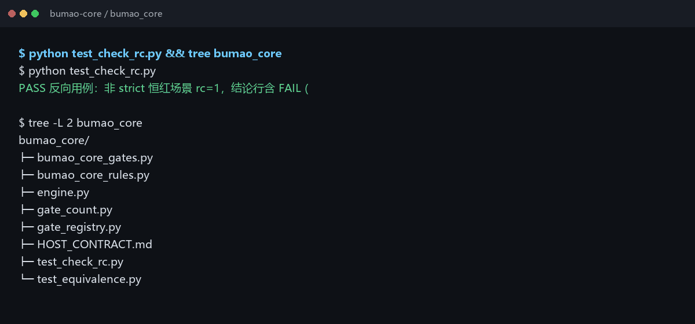
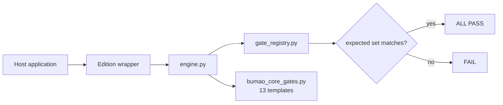

# Bumao Core

Status: maintenance pause
状态：维护暂停，稳定可用


> **Two version spaces** — the kernel version declared in `kernel_contract.json` is `0.10`; the repository tag is a separate numbering space: the latest stable tag is `v0.12`, and the current prerelease is `v0.2.0-beta.5`. They are independent numbers, not the same number.
> **两个版本空间** — `kernel_contract.json` 声明的内核版本是 `0.10`；仓库 tag 是另一个编号空间：最新稳定 tag 是 `v0.12`，当前预发行是 `v0.2.0-beta.5`。两者是独立编号，不是同一个数字。
>
> **Cold start** — to resume iteration, start from [`RETURN_HERE.md`](RETURN_HERE.md).
> **冷启动** — 恢复迭代从 [`RETURN_HERE.md`](RETURN_HERE.md) 开始。

Stdlib-only rule-execution kernel for AI agents: one written rule set in, one deterministic `ALL PASS` / `FAIL` verdict out — and the verdict cannot be silently loosened.

**What it is** — a kernel, not a framework. It ships no rules of its own.
**Who it's for** — developers building their own host who want the same verdict logic underneath.
**What it solves** — the same rule set being judged differently by different implementations.


*Real output: `test_check_rc.py` plus the shipped `bumao_core/` tree. Terminal capture, no mock UI.*

## Quick start (30 seconds)

```bash
git clone -b v0.12 https://github.com/Bumao-Ai/Bumao-core.git
cd Bumao-core
python bumao_core/test_check_rc.py     # smoke test, prints PASS
```

Then wire it into your own host. The snippet below runs from the repository root; two symbols are yours to supply and are marked `# replace`:

```python
import sys
sys.path.insert(0, "bumao_core")                  # repo-relative, no change needed
import engine as core

core.configure(rules_db_module=my_rules_db)       # replace my_rules_db with your rules module
core.register("B1", my_gate, "my first gate")     # replace my_gate with your gate function
core.set_expected("MyEdition", frozenset(["B1"])) # anti-shrink baseline
raise SystemExit(core.main(["check", "--strict"]))# exit code is the verdict
```

Two symbols are host-supplied: `my_rules_db` (your rules module) and `my_gate` (your gate function). Everything else in the block is copy-paste as is.

Subcommands: `whoami` (`--full`), `check` (`--strict`, `--quick`), `audit`, `bump`, `show <clause-id>`, `selftest` (`--kernel`), `refresh`.

- `check --quick` runs the A-section structural gates only; it skips the host-injected B/Z gates, the anti-shrink reconciliation and the check-credential write. Its verdict line says it cannot replace `check --strict` in both branches: `[结论] ALL PASS（quick：仅 A 段 N 项，B/Z 段未跑）—— 不能替代 check --strict` on pass, and `FAIL (…；quick 仅 A 段，B/Z 未跑 —— 不能替代 check --strict)` on fail.
- `--strict` is a legacy-compatible flag: every FAIL already returns a non-zero exit code, so it does not change any judgement.
- `whoami --full` appends four diagnostic lines; without it the output is byte-identical to earlier versions.

## Self-test: kernel vs host

Two entries, deliberately separate — the kernel one needs no host:

```bash
python -m bumao_core.engine selftest --kernel   # kernel self-test, no rules_db required
python -m bumao_core.engine selftest            # host integration; without configure() it prints
                                                # "内核自检需宿主注入规则库（rules_db）…" and exits 2
python contract_test.py                         # full governance contract test
```

`selftest --kernel` checks six things: engine import, CLI parser (7 subcommands, no duplicate registration), `Out` counting, the anti-shrink round trip, `gate_registry` importability plus the A10 verdict, and the explicit error when `rules_db` is missing.

## Install as a package (optional)

```bash
pip install -e .
python -c "from bumao_core import engine; print(engine.build_parser().prog)"
```

Both loading styles work on the same file: `pip install -e .` + `from bumao_core import engine`, or the historical `sys.path.insert(0, "bumao_core")` + `import engine`. `pyproject.toml` only declares packaging; it does not add runtime dependencies (stdlib only).

## Proof of work

| Item | Value | Source |
|---|---|---|
| Commits at `v0.2.0-beta.5` | 16 | `git rev-list --count v0.2.0-beta.5` |
| Last commit | 2026-11-09 | `git log -1 --date=short` |
| Check items | 13 gate templates | `bumao_core/bumao_core_gates.py` (`make_*_gate`) |
| Shipped tests | `test_check_rc.py` · `test_build_parser.py` · `test_a10_policy.py` (7/7) · `test_gate_registry.py` | `python bumao_core/<test>.py` |
| Defect ledger | not kept in this repo | — |
| Releases | 8 tags, `v0.1` → `v0.2.0-beta.5`, all 2026-11 | `git tag` |
| Changelog | [CHANGELOG.md](CHANGELOG.md) | — |

## 中文

- **是什么**：一个内核，不是框架；本身不含任何具体规则。
- **给谁用**：要自己搭宿主、但想复用同一套判定逻辑的开发者。
- **解决什么**：同一份规则在不同实现里被判出不同结论。

快速开始沿用上方代码块。宿主必须实现的 12 个成员见 [`bumao_core/HOST_CONTRACT.md`](bumao_core/HOST_CONTRACT.md)；`bumao_core/bumao_core_rules.py` 是参考实现、不参与运行时；可直接复制运行的最小接入样例见 [`examples/minimal_host.py`](examples/minimal_host.py)。配套发行版见 `bumao-xtgl-community`（59 rules / 44 checks）与 `bumao-xtgl-minimal`（0 rules / 28 checks）。

## Roadmap (0.2 — in progress)

Three pieces are under construction. `v0.2.0-beta.3` changes the kernel runtime: gate `A10` now returns an explicit `PASS`/`DENY` verdict instead of a “ledger not found” hint, and `gate_registry.py` gains the `GateRegistry` class. The contract self-test is green in this repo.

1. **Pre-execution constraint** — declare intent before acting; the intent is reviewed before the action runs. Wired in the personal edition's MCP `file_write` path: `path` + `intent` go through the L3 review before dispatch. **Default off** — no launcher starts the MCP server, so nothing is intercepted unless you start it. Controlled run in beta.3: in-scope write allowed; out-of-scope write denied and the target file's SHA-256 unchanged before/after. Not wired into the kernel's own `check --strict` path. *(in progress)*
2. **In-flight supervision** — check continuously while the action is in progress, not only at the end. Design and sandbox prototype pass; **not wired into the live path**. *(in progress)*
3. **Post-execution audit** — link action, basis, result and exception into one traceable chain. Wired in the personal edition (`ledger.py shenji`). *(in progress)*

Status: **in progress** — pre-execution intent is wired and default-off in the personal edition; in-flight supervision is design-and-sandbox only; the kernel's own check path is unchanged.

## Architecture



## What gets checked

| Area | Templates | Examples |
|---|---|---|
| Rule source structure | 6 | chapter count, unique IDs, contiguous blocks, missing keys, shell clauses, broken references |
| Rendered views | 2 | view drift, render idempotence |
| Repository layout | 2 | root files not flat, sub-directory naming |
| Hygiene | 3 | PII/path scan, stale lock, version syntax |

Total: 13 gate templates. A host supplies the rule set and the gate functions; the kernel supplies the contract, the registry and the verdict.

## Layout

```
bumao_core/
  engine.py            唯一运行时引擎
  gate_registry.py     gate registry, anti-shrink checks, explicit A10 verdict
  gate_count.py        three-caliber gate counting
  bumao_core_gates.py  13 reusable gate templates
  bumao_core_rules.py  参考装载器（参考实现，不参与运行时）
  host_reference.py    minimal host skeleton (GateRegistry only)
  __init__.py          package entry for `pip install -e .`
  test_check_rc.py     exit-code regression
  test_build_parser.py CLI parser regression (duplicate-subcommand defect)
  test_a10_policy.py   A10 verdict cases (DENY / PASS)
  test_gate_registry.py registry add/remove regression
  test_equivalence.py  engine equivalence regression
  HOST_CONTRACT.md     the 12 members a host must implement
examples/
  minimal_host.py      standalone third-party integration sample (no editions needed)
kernel_contract.json   frozen interface contract (read by A10, one level above bumao_core/)
contract_test.py       contract self-test
pyproject.toml         packaging only (pip install -e .), no runtime dependencies
30_taizhang/
  shenpi_jilu.txt      approval-ledger structure template (A10 input; no entries → DENY)
assets/                official logos
```

`kernel_contract.json` must stay one level **above** `bumao_core/` (repository root here, `kernel/` in the editions). That is the path `engine.py` reads; without it, gate `A10` fails with `FileNotFoundError`.

## Status and known issues

- `contract_test.py` is green: `12 项，0 FAIL，0 SKIP，3 N/A`. The three N/A lines are the internal-only modules (`facts.py`, `facts_check.py`, `portability_probe.py`), declared **out of contract scope** in `HOST_CONTRACT.md §十` — they are not optional dependencies and the result is no longer a “skip”. A missing core file is still a FAIL.
- `check --strict` in this repo is `1/12` red: `A10` is `DENY` by design (the shipped approval-ledger template has no entries). `A13` seeds its baseline on first run and then passes. In an existing working tree that already has an A13 baseline, editing a core file without a same-day approval entry turns `A13` red by design.
- `bumao_core/gate_count.py` and `bumao_core/test_equivalence.py` require the `<HX>/kernel/bumao_core` layout with all three editions checked out as siblings. Outside that layout they print `需要三端同级检出` and exit `2` — not PASS, not FAIL, so a single-repo clone cannot report a false green or a misleading red.
- `python examples/minimal_host.py` runs a real check without any edition. Its `check` exit code is `1` because the sample ships no approval ledger, so `A10` is `DENY` by design; the script prints this explicitly.

## Docs / License

- Host contract: [`bumao_core/HOST_CONTRACT.md`](bumao_core/HOST_CONTRACT.md)
- Contributing: [`CONTRIBUTING.md`](CONTRIBUTING.md) · DCO: [`DCO`](DCO)
- Security: [`SECURITY.md`](SECURITY.md)
- License: Apache-2.0, see [`LICENSE`](LICENSE)
- Trademark boundary: [`TRADEMARK.md`](TRADEMARK.md)

Copyright 2026 Bumao
