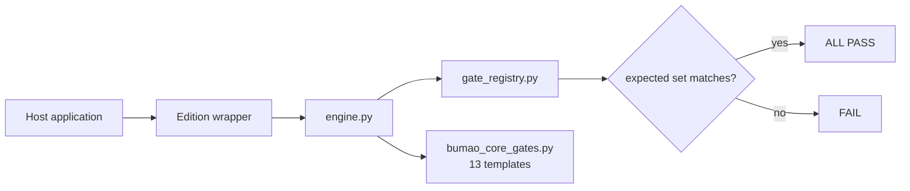

# Bumao Core


> **Two version spaces** — the kernel version declared in `kernel_contract.json` is `0.10`; the repository release tag is `v0.12`. They are two independent numbering spaces, not the same number.
> **两个版本空间** — `kernel_contract.json` 声明的内核版本是 `0.10`；仓库发布 tag 是 `v0.12`。这是两个独立的编号空间，不是同一个数字。

Stdlib-only rule-execution kernel for AI agents: one written rule set in, one deterministic `ALL PASS` / `FAIL` verdict out — and the verdict cannot be silently loosened.

**What it is** — a kernel, not a framework. It ships no rules of its own.
**Who it's for** — developers building their own host who want the same verdict logic underneath.
**What it solves** — the same rule set being judged differently by different implementations.


*Real output: `test_check_rc.py` plus the shipped `bumao_core/` tree. Terminal capture, no mock UI.*

## Quick start (30 seconds)

```bash
git clone -b v0.12 https://github.com/Bumao-Ai/Bumao-core.git
cd Bumao-core
python bumao_core/test_check_rc.py     # smoke test, prints PASS
```

Then wire it into your own host. The snippet below runs from the repository root; two symbols are yours to supply and are marked `# replace`:

```python
import sys
sys.path.insert(0, "bumao_core")                  # repo-relative, no change needed
import engine as core

core.configure(rules_db_module=my_rules_db)       # replace my_rules_db with your rules module
core.register("B1", my_gate, "my first gate")     # replace my_gate with your gate function
core.set_expected("MyEdition", frozenset(["B1"])) # anti-shrink baseline
raise SystemExit(core.main(["check", "--strict"]))# exit code is the verdict
```

Two symbols are host-supplied: `my_rules_db` (your rules module) and `my_gate` (your gate function). Everything else in the block is copy-paste as is.

Subcommands: `whoami`, `check` (`--strict`), `audit`, `bump`, `show <clause-id>`, `selftest`, `refresh`.

## Proof of work

| Item | Value | Source |
|---|---|---|
| Commits at `v0.12` | 5 | `git rev-list --count v0.12` |
| Last commit | 2026-11-08 | `git log -1 --date=short` |
| Check items | 13 gate templates | `bumao_core/bumao_core_gates.py` (`make_*_gate`) |
| Reverse cases | 1 | `python bumao_core/test_check_rc.py` → `PASS` |
| Defect ledger | not kept in this repo | — |
| Releases | 3 tags, `v0.1` → `v0.12`, all 2026-11-08 | `git tag` |
| Changelog | [CHANGELOG.md](CHANGELOG.md) | — |

## 中文

- **是什么**：一个内核，不是框架；本身不含任何具体规则。
- **给谁用**：要自己搭宿主、但想复用同一套判定逻辑的开发者。
- **解决什么**：同一份规则在不同实现里被判出不同结论。

快速开始沿用上方代码块。宿主必须实现的 12 个成员见 [`bumao_core/HOST_CONTRACT.md`](bumao_core/HOST_CONTRACT.md)；配套发行版见 `bumao-xtgl-community`（59 rules / 44 checks）与 `bumao-xtgl-minimal`（0 rules / 28 checks）。

## Roadmap (0.2 — in progress)

Three pieces are under construction. None of them is shipped in this release.

1. **Pre-execution constraint** — declare intent before acting; the kernel judges the intent before the action runs. Design and sandbox prototype pass; **not wired into the live path**. *(in progress)*
2. **In-flight supervision** — check continuously while the action is in progress, not only at the end. Design and sandbox prototype pass; **not wired into the live path**. *(in progress)*
3. **Post-execution audit** — link action, basis, result and exception into one traceable chain. Design and sandbox prototype pass; **not wired into the live path**. *(in progress)*

Status: **in progress** — design and sandbox prototypes are done; live integration is not. This section is a commitment, not a claim of completion.

## Architecture



## What gets checked

| Area | Templates | Examples |
|---|---|---|
| Rule source structure | 6 | chapter count, unique IDs, contiguous blocks, missing keys, shell clauses, broken references |
| Rendered views | 2 | view drift, render idempotence |
| Repository layout | 2 | root files not flat, sub-directory naming |
| Hygiene | 3 | PII/path scan, stale lock, version syntax |

Total: 13 gate templates. A host supplies the rule set and the gate functions; the kernel supplies the contract, the registry and the verdict.

## Layout

```
bumao_core/
  engine.py            唯一运行时引擎
  gate_registry.py     expected-set registry and anti-shrink checks
  gate_count.py        three-caliber gate counting
  bumao_core_gates.py  13 reusable gate templates
  bumao_core_rules.py  reference loaders for three rule formats
  test_check_rc.py     exit-code regression
  test_equivalence.py  engine equivalence regression
  HOST_CONTRACT.md     the 12 members a host must implement
kernel_contract.json   frozen interface contract (read by A10, one level above bumao_core/)
contract_test.py       contract self-test
assets/                official logos
```

`kernel_contract.json` must stay one level **above** `bumao_core/` (repository root here, `kernel/` in the editions). That is the path `engine.py` reads; without it, gate `A10` fails with `FileNotFoundError`.

## Known issues (not fixed in this batch)

- `contract_test.py` reports `2 FAIL` out of 12: checks `[B]` and `[C]` expect five modules this repo does not ship (`facts.py`, `facts_check.py`, `host_reference.py`, `portability_probe.py`, `test_gate_registry.py`). The contract file itself passes every `[A]`/`[D]`/`[E]`/`[F]` check.
- `bumao_core/gate_count.py` reports `FAIL` for `bumao-xtgl-community` and `bumao-xtgl-minimal`, and `bumao_core/test_equivalence.py` reports `FAIL`: both assume the three editions are checked out as siblings under one work area. On a single-repo clone they cannot resolve the sibling paths and fail. Not fixed this batch.

## Docs / License

- Host contract: [`bumao_core/HOST_CONTRACT.md`](bumao_core/HOST_CONTRACT.md)
- Contributing: [`CONTRIBUTING.md`](CONTRIBUTING.md) · DCO: [`DCO`](DCO)
- Security: [`SECURITY.md`](SECURITY.md)
- License: Apache-2.0, see [`LICENSE`](LICENSE)
- Trademark boundary: [`TRADEMARK.md`](TRADEMARK.md)

Copyright 2026 Bumao
